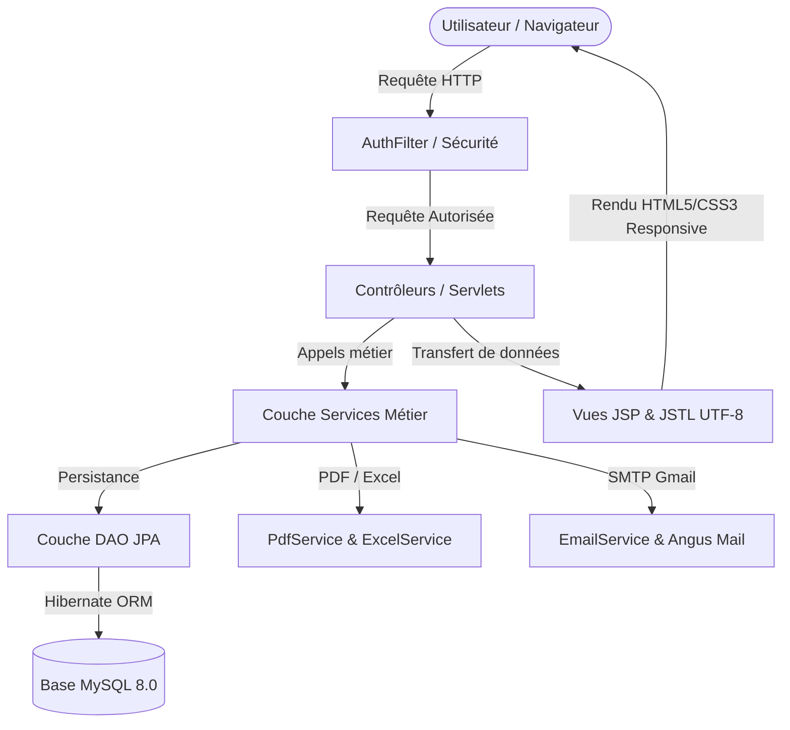
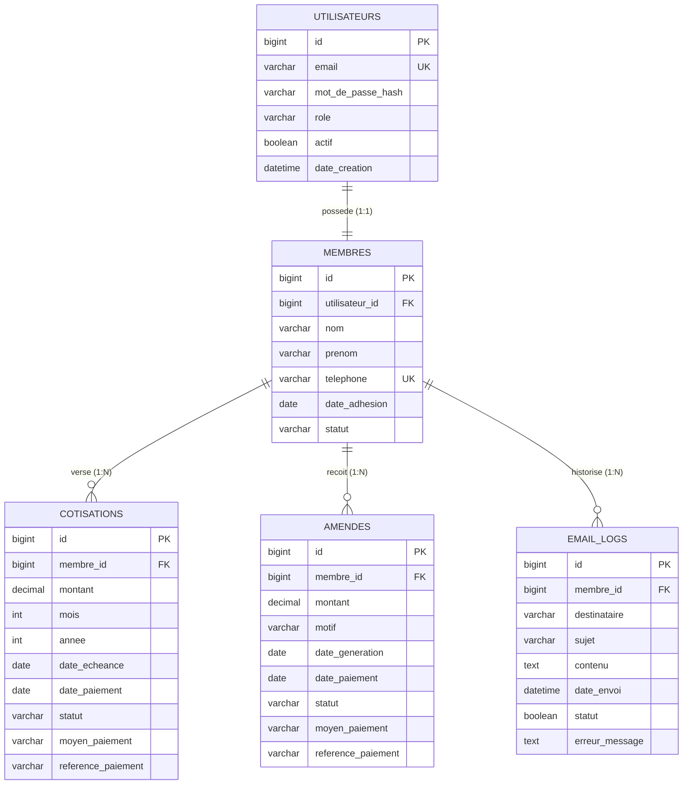

# 📋 Rapport Récapitulatif du Projet : Système de Gestion des Cotisations UCAD

---

## 📌 1. Présentation Générale du Projet

Le projet **Système de Gestion des Cotisations UCAD** est une application web d'entreprise moderne développée pour l'**Université Cheikh Anta Diop de Dakar (UCAD)**. Elle a pour vocation d'automatiser et de fiabiliser l'ensemble des processus de gestion des cotisations mensuelles, de calcul et de suivi des amendes de retard, de gestion des membres, ainsi que de reporting financier et d'envoi de notifications par e-mail.

### 🎯 Objectifs Principaux
- **Gestion centralisée des membres** (adhésion, profil, statut actif/inactif, suivi par identifiant unique).
- **Génération automatique et suivi des cotisations mensuelles**.
- **Gestion des paiements modernes multicanaux** :
  - **Mobile Money** : Wave, Orange Money.
  - **Carte Bancaire** : Visa, Mastercard.
  - **Virement bancaire** direct sur le compte de l'UCAD.
- **Détection automatique des retards et application d'amendes**.
- **Édition de reçus et bilans PDF professionnels** avec l'identité visuelle de l'UCAD.
- **Exportation des données au format Excel (`.xlsx`)** avec mise en forme dynamique.
- **Système de notifications par e-mail (SMTP Gmail / Jakarta Mail)** avec traçabilité complète des envois dans `email_logs`.
- **Sécurité et contrôle d'accès basé sur les rôles (RBAC)** : Espace Administrateur & Espace Membre.

---

## 🛠️ 2. Stack Technologique & Dépendances

L'application repose sur les standards **Jakarta EE 10** et l'écosystème Java moderne :

| Composant / Rôle | Technologie / Bibliothèque | Version |
| :--- | :--- | :--- |
| **Langage & Plateforme** | Java SE (JDK) | **17 (LTS)** |
| **Standard Entreprise** | Jakarta EE Web API (Servlet 6.0, JSP 3.1, JPA 3.1, CDI 4.0) | **10.0.0** |
| **ORM / Persistance** | Hibernate ORM | **6.4.4.Final** |
| **Injection de Dépendances** | JBoss Weld (Servlet Core CDI) | **5.1.2.Final** |
| **Bases de Données** | MySQL 8.0 & PostgreSQL (support multi-driver) | **8.4.0 / 42.7.2** |
| **Moteur de Vues** | JSP 3.1 / Jakarta Standard Tag Library (JSTL) (100% UTF-8) | **3.0.1** |
| **Sécurité & Hashage** | jBCrypt (Algorithme Blowfish sécurisé) | **0.4** |
| **Génération PDF** | OpenPDF (LibrePDF) | **1.3.39** |
| **Génération Excel** | Apache POI (poi-ooxml) | **5.2.5** |
| **Messagerie E-mail** | Jakarta Mail & Eclipse Angus Mail (SMTP TLS / Gmail) | **2.1.3 / 2.0.3** |
| **Serveur d'application** | Apache Tomcat | **10.1+** |
| **Conteneurisation** | Docker (Multi-stage build) & Docker Compose (MySQL 8 + Tomcat) | - |

---

## 🏗️ 3. Architecture Logicielle

Le projet est conçu selon le patron d'architecture **MVC (Modèle - Vue - Contrôleur)** en couches distinctes, garantissant une forte cohésion et un faible couplage :

```
sn.ucad.cotisations
 ├── config/        # Configuration centralisée (.env & AppConfig) & cycle de vie JPA résilient (JpaUtil)
 ├── dao/           # Couche d'accès aux données (Data Access Object)
 ├── filter/        # Filtres HTTP de sécurité et contrôle d'accès (AuthFilter)
 ├── listener/      # Initialisation du contexte applicatif & bootstrap BDD (AppInitializerListener)
 ├── model/         # Entités JPA et Énumérations métier
 ├── service/       # Couche Métier (Logique d'affaires, PDF, Excel, Mail)
 └── servlet/       # Contrôleurs HTTP (Servlets Jakarta)
```



---

## 💾 4. Modèle de Données & Entités JPA

Le schéma relationnel est modélisé avec JPA 3.1 / Hibernate 6 et s'articule autour de 5 tables principales :



---

## ⚙️ 5. Résilience de Démarrage & Infrastructure Docker

### Correction de l'erreur `EntityManagerFactory non initialisée`
* **Cause résolue** : Lenteur d'initialisation de MySQL 8 au premier lancement par rapport à Tomcat qui démarrait trop rapidement.
* **Solutions intégrées** :
  1. **Healthcheck MySQL dans Docker Compose** : Le conteneur `app` dépend de l'état `condition: service_healthy` du conteneur `db` via `mysqladmin ping`.
  2. **Boucle de Retry dans `JpaUtil.java`** : Tentative de connexion jusqu'à 12 fois avec intervalle de 3 secondes avant échec.
  3. **Initialisation paresseuse (Lazy init)** : `JpaUtil.getEntityManager()` réessaie automatiquement l'initialisation si la factory n'était pas ouverte.
  4. **Suppression du doublon `COPY` dans le Dockerfile** : Déploiement unique sur `ROOT.war` (évitant le double chargement des listeners JPA).
  5. **Sécurisation des identifiants** : Utilisation d'un fichier `.env` non commité pour les mots de passe MySQL et SMTP, avec fallback dynamique dans `AppConfig.java`.

---

## 🎨 6. Interface Utilisateur & Expérience Graphique (UI/UX)

- **Blason Officiel de l'Université (Vectoriel SVG)** :
  - Création d'un logo écusson officiel (`src/main/webapp/assets/img/ucad-logo.svg`) représentant les symboles académiques (livre ouvert, lauriers, sceau de trésorerie FCFA, étoile nationale).
  - Intégration en tant que favicon officiel sur toutes les pages et en tête de la barre latérale et page de login.
- **Canaux de Paiement Modernes & Centrage de Page** :
  - Mise en page centrée (`max-width: 620px; margin: 0 auto`) éliminant le vide latéral.
  - Cartes de paiement interactives avec logos officiels :
    - 🐧 **Wave** (`wave.svg`)
    - 🟠 **Orange Money** (`orange-money.svg`)
    - 💳 **Carte Bancaire** (`visa.svg` et `mastercard.svg`)
    - 🏦 **Virement bancaire**
- **Encodage & Typographie 100% UTF-8** :
  - Correction et validation de tous les caractères accentués (`é`, `è`, `à`, `ç`, etc.) dans les JSP, headers et pied de page institutionnel.
- **Responsivité Mobile & Tablette** :
  - Menu latéral tiroir (drawer mobile) avec bouton hamburger `bi-list` et voile semi-transparent pour les smartphones.
  - Défilement tactile fluide sur la barre adhérent.

---

## 📁 7. Inventaire des Fichiers Clés Développés

| Catégorie | Fichier | Rôle & Description |
| :--- | :--- | :--- |
| **Build & Config** | `pom.xml` | Dépendances Maven Jakarta EE 10, Hibernate 6, POI, OpenPDF, JSTL, BCrypt |
| | `Dockerfile` | Image Docker multi-stage (Maven 3.9 JDK 17 -> Tomcat 10.1) |
| | `docker-compose.yml` | Orchestration multi-conteneurs (MySQL 8.0 + Tomcat 10.1) |
| | `.env` / `.env.example` | Variables d'environnement pour MySQL et SMTP Gmail |
| | `persistence.xml` | Unité de persistance JPA `CotisationPU` (MySQL) et `ucadCotisationsPU` (PostgreSQL) |
| | `web.xml` | Configuration Servlet 6.0, UTF-8 forcé, listeners CDI et JPA |
| **Java** | `AppConfig.java` | Lecture hiérarchique : variables d'environnement en priorité, puis `application.properties` |
| | `JpaUtil.java` | Gestionnaire résilient de l'EntityManagerFactory (retry automatique + lazy init) |
| | `AppInitializerListener.java` | Initialisation de la base, exécution des scripts seed et création du compte admin |
| | `EmailService.java` | Envoi d'e-mails HTML via Jakarta Mail / SMTP Gmail avec traçabilité |
| | `CotisationServlet.java` / `AmendeServlet.java` | Contrôleurs de paiement et gestion des transactions |
| **Vues & Assets** | `ucad-logo.svg` | Blason vectoriel officiel de l'UCAD |
| | `wave.svg`, `orange-money.svg`, `visa.svg`, `mastercard.svg` | Logos vectoriels des moyens de paiement |
| | `cotisations/paiement.jsp` / `amendes/paiement.jsp` | Interfaces de paiement centrées avec sélection par cartes |
| | `membres/liste.jsp` / `membres/detail.jsp` | Affichage des vrais IDs des membres (`#ID`) |
| | `header.jsp` / `footer.jsp` | En-tête et pied de page institutionnels responsives |

---

## 🚀 8. Guide de Lancement

### Lancement avec Docker Compose (Recommandé)
```bash
docker compose up -d --build
```
L'application est immédiatement disponible sur : **`http://localhost:8081/`**

### Lancement avec Eclipse IDE
1. Importer le projet via **`Import... > Existing Maven Projects`**.
2. Configurer un serveur **`Apache Tomcat v10.1`** avec **JDK 17**.
3. Dans la configuration du serveur (onglet *Environment*), définir les variables `DB_URL`, `DB_USER`, `DB_PASSWORD`, `SMTP_HOST`, `SMTP_PORT`, `SMTP_USERNAME`, `SMTP_PASSWORD`.
4. Démarrer Tomcat et accéder à : **`http://localhost:8080/`** (ou `/cotisations-app/`).

### 🔑 Identifiants Administrateur par Défaut :
- **E-mail** : `admin@ucad.sn`
- **Mot de passe** : `admin123`

---

*Document mis à jour pour consigner l'intégralité des réalisations techniques, architecturales et graphiques du projet.*
